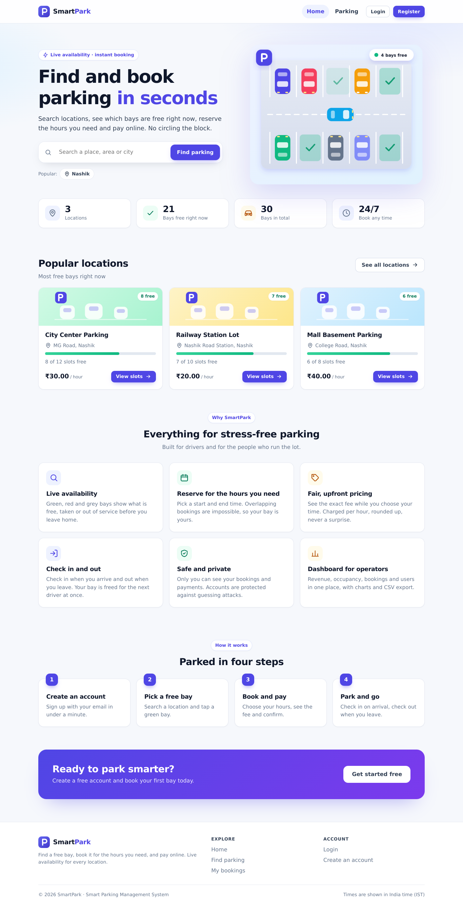
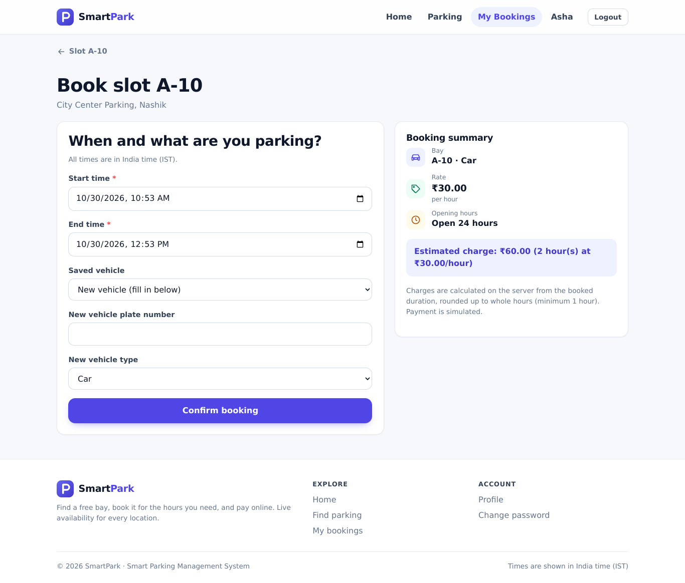
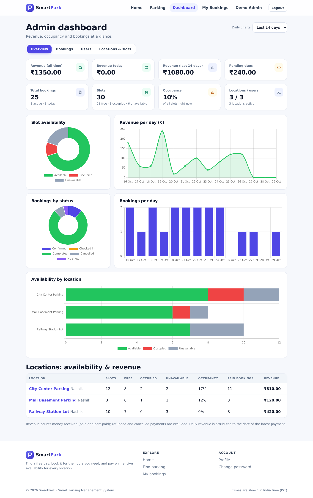

# SmartPark: Smart Parking Management System

A web application for finding, booking and managing parking. Drivers search locations, see live slot availability, book a slot for a time range, get the fee calculated
automatically, pay (simulated), check in and out, and review their history. Administrators manage locations, slots, users, bookings and payments, and see revenue and
availability on a dashboard with charts. Everything is also available through a documented REST API.

Built with **Python, Django, Django REST Framework, Django Templates, HTML, CSS and JavaScript** (Chart.js for the charts). SQLite by default; MySQL by configuration.
No React or Node.js (Node is only needed to run the optional Postman/Newman API tests).



| Booking | Admin dashboard |
|---|---|
|  |  |

More screenshots (phone layouts, locations, login, history) are in [docs/screenshots/](docs/screenshots/).

## Quick start

```bash
python -m venv venv
source venv/bin/activate              # Windows: venv\Scripts\activate
pip install -r requirements.txt
python manage.py migrate
python manage.py seed_demo            # optional: demo locations, bookings and accounts (prints the logins)
python manage.py runserver            # http://127.0.0.1:8000
```

Demo accounts (only created by `seed_demo`, which refuses to run in production): **admin_demo / DemoAdmin#2026** and **user_demo / DemoUser#2026**.
Without demo data, create your own admin with `python manage.py createsuperuser` (superusers automatically get the admin role) and add locations from the *Parking* page.

Configuration is optional for development: copy `.env.example` to `.env` to change anything (it is loaded automatically).

## Documentation

| Document | What is in it |
|---|---|
| [docs/screenshots/](docs/screenshots/) | Screenshots of the main pages on desktop and phone, produced by `tools/screenshots.mjs` |
| [docs/USER_GUIDE.md](docs/USER_GUIDE.md) | How to use the site as a driver and as an administrator, plus a 10-minute demonstration script |
| [docs/API.md](docs/API.md) | Every REST endpoint with parameters, rules, errors and real example responses |
| [docs/postman/](docs/postman/) | Postman collection and environment (64 requests, 109 assertions) |
| [docs/DATABASE.md](docs/DATABASE.md) | Tables, columns, constraints and an ER diagram |
| [docs/TESTING.md](docs/TESTING.md) | What is tested and how, results, performance sanity check, what is not covered, manual acceptance checklist |
| [docs/DEPLOYMENT.md](docs/DEPLOYMENT.md) | Environment variables, production setup (gunicorn, WhiteNoise, nginx, MySQL), scheduled jobs, troubleshooting |
| [docs/REQUIREMENTS_CHECKLIST.md](docs/REQUIREMENTS_CHECKLIST.md) | Every assignment requirement with its status, and the known limitations |
| [CHANGELOG.md](CHANGELOG.md) | What was built in each phase |

## How it works

**Roles.** *Visitors* can browse. *Users* book and manage their own bookings. *Admins* (role `admin`) use the dashboard. Users only ever see their own bookings, payments and vehicles.

**Booking rules.** Start in the future; 30 minutes to 24 hours long; up to 30 days ahead; inside the location's opening hours; slot free for the whole period (back-to-back is fine);
slot not under maintenance; vehicle type fits the slot. Overlaps are checked inside a database transaction that locks the slot, so simultaneous requests cannot double-book
(verified with a multi-threaded test).

**Pricing.** `hourly rate x hours`, rounded up to whole hours, minimum one hour, always calculated on the server. The rate is saved with the booking, so later rate changes do not
affect it. Leaving early does not reduce the charge; staying past the end is billed for the actual time.

**Payments are simulated.** There is no payment gateway and no real money moves; the pay page says so and every payment is flagged `is_simulated`. Statuses: pending, paid, failed, refunded, cancelled.
Cancelling a paid booking records a simulated refund.

**Check-in and check-out.** Check-in opens 15 minutes before the start and marks the slot occupied; check-out completes the booking and frees the slot. Cancelling is allowed until 60 minutes before the start.
Unused, finished bookings become *no-shows* (not charged) when `python manage.py expire_bookings` runs (schedule it, see [DEPLOYMENT.md](docs/DEPLOYMENT.md)).
The numbers above are settings in `config/settings.py`.

## Project layout

```
config/            settings (environment based), URLs, WSGI/ASGI, .env loader
apps/accounts/     registration, login, profiles, roles, token API, login throttling
apps/parking/      locations and slots: pages, admin CRUD, API, demo-data commands
apps/bookings/     vehicles and bookings: rules, services, pages, API, no-show command
apps/payments/     pricing, simulated payments, refunds, admin payment status, API
apps/dashboard/    admin statistics, bookings and users management, CSV export, summary API
apps/core/         home page, security headers, shared helpers, cross-cutting tests
templates/ static/ HTML templates; CSS design system, SVG illustrations and icons, JavaScript (no inline scripts); vendored Chart.js
docs/ tools/       documentation, screenshots, and the tools that keep the docs in sync (build_docs.py) and check the UI in a real browser (screenshots.mjs)
```

## Tests

```bash
python manage.py test                 # the automated suite
bash tools/run_postman.sh             # the API collection against a throw-away database (needs Node.js)
python tools/build_docs.py --check    # generated docs are up to date
```

See [docs/TESTING.md](docs/TESTING.md) for coverage, the stress and edge-case tests, and what has *not* been tested (a real browser, MySQL, a live host).

## Security in brief

CSRF protection everywhere, ownership checks on every private resource (web and API), server-side validation, login lockout and API rate limits, Content-Security-Policy with no inline scripts,
secure cookies/HTTPS redirect/HSTS in production, and a start-up guard that refuses the development secret key when `DJANGO_DEBUG=False`. Details and limits: [docs/DEPLOYMENT.md](docs/DEPLOYMENT.md) and [docs/REQUIREMENTS_CHECKLIST.md](docs/REQUIREMENTS_CHECKLIST.md).

## Known limitations

Payments are simulated; no password-reset or email flow; API tokens do not expire; not yet deployed to a live host, tested on MySQL, or checked on Firefox, Safari or a physical phone (the pages were checked in headless Chrome only). The full list is in
[docs/REQUIREMENTS_CHECKLIST.md](docs/REQUIREMENTS_CHECKLIST.md).

## Third-party

Chart.js 4.4.7 (MIT licence, `static/js/vendor/chart.js-LICENSE.md`) is included so the dashboard works without a CDN. Python dependencies are listed in `requirements.txt`
(and `requirements-prod.txt` for production).
