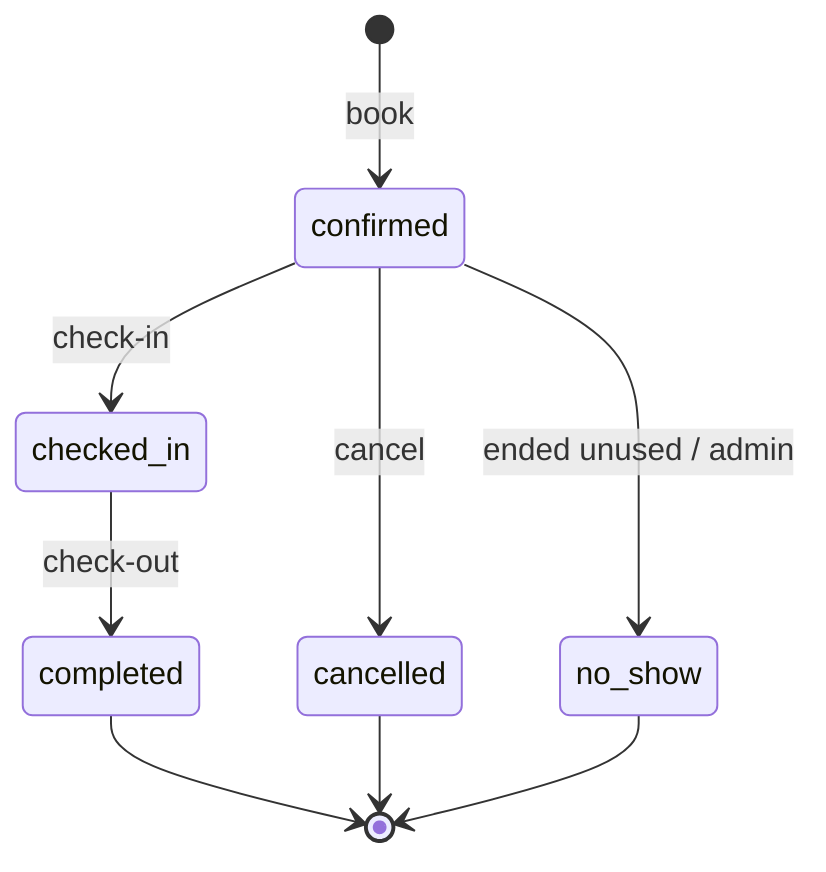
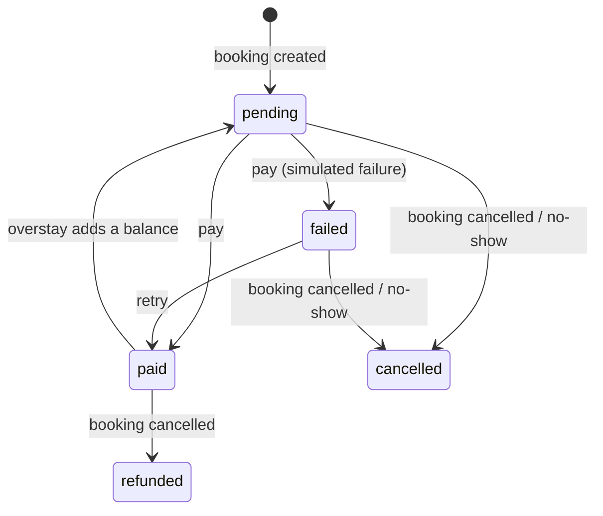

# SmartPark REST API

Reference for the JSON API behind the Smart Parking Management System. Every endpoint below is exercised by the
[Postman collection](postman/SmartParking.postman_collection.json) (`docs/postman/`), which is run with Newman as part of
the delivery checks. Example responses on this page are captured from the running code, not typed by hand
(`python tools/build_docs.py` regenerates them).

## Conventions

| Topic | Rule |
|---|---|
| Base URL | `http://127.0.0.1:8000` while developing. Every URL **ends with a slash**. |
| Format | Requests and responses are JSON (`Content-Type: application/json`). |
| Authentication | `Authorization: Token <key>` (get a key from register or login). The website's session cookie also works but then needs a CSRF token; API clients should use tokens. Tokens do not expire; logging out revokes them. |
| Roles | **Public** (no login), **User** (any logged-in account) and **Admin** (role `admin`). Users only ever see their own bookings, payments and vehicles; other people's items answer `404`. |
| Money | Strings with two decimals in Indian rupees, e.g. `"60.00"`. |
| Date and time | ISO 8601 with offset (`2026-11-02T10:00:00+05:30`). Input without an offset is read in the site time zone, India time (Asia/Kolkata). |
| Pagination | List endpoints return `{"count", "next", "previous", "results"}`, 20 per page, `?page=2`. |
| Rate limits | Register and login: 20 requests/minute per client IP (`DJANGO_AUTH_THROTTLE`). After 5 failed logins for one username from one IP (or 20 from one IP) logins are refused for 15 minutes. Both answer `429` with a `Retry-After` header. |

### Errors

| Status | Meaning | Body |
|---|---|---|
| 400 | Validation problem or a booking/payment rule was broken | Field errors `{"email": ["..."]}`, `{"non_field_errors": ["..."]}`, or for business rules `{"detail": ["..."]}` |
| 401 | Missing or invalid token | `{"detail": "Authentication credentials were not provided."}` |
| 403 | Logged in but not allowed (for example a user calling an admin endpoint) | `{"detail": "..."}` |
| 404 | Not found, or it belongs to someone else | `{"detail": "Not found."}` |
| 409 | Cannot delete because related bookings exist | `{"detail": "..."}` |
| 429 | Throttled or temporarily locked out | `{"detail": "..."}` + `Retry-After` |

Malformed filters (for example `?location=abc`) are a `400` that names the parameter; they are never a server error.

### Endpoint index

| Area | Endpoints |
|---|---|
| Authentication | `POST /api/auth/register/` `POST /api/auth/login/` `POST /api/auth/logout/` `GET,PATCH /api/auth/profile/` |
| Parking | `/api/parking/locations/` `/api/parking/locations/{id}/` `/api/parking/slots/` `/api/parking/slots/{id}/` |
| Vehicles | `/api/bookings/vehicles/` `/api/bookings/vehicles/{id}/` |
| Bookings | `/api/bookings/` `/api/bookings/{reference}/` and the actions `cancel`, `check-in`, `check-out`, `status` |
| Payments | `/api/payments/estimate/` `/api/payments/` `/api/payments/{id}/` and the actions `pay`, `status` |
| Administration | `GET /api/dashboard/summary/` |

---

## Authentication

### POST /api/auth/register/

Public. Creates a `user` account (the role cannot be chosen) and returns a token.

| Field | Required | Notes |
|---|---|---|
| `username` | yes | Up to 150 characters: letters, digits and `@ . + - _` |
| `password` | yes | Checked by Django's password rules (8+ characters, not common, not all digits, not too similar to your details) |
| `first_name` | yes | |
| `last_name` | no | |
| `email` | yes | Must be unique (case-insensitive) |
| `phone` | no | 10-15 digits, optional leading `+` |

`201` 
```json
{
  "token": "9944b09199c62bcf9418ad846dd0e4bbdfc6ee4b",
  "user": {
    "id": 2,
    "username": "asha",
    "first_name": "Asha",
    "last_name": "Kulkarni",
    "email": "asha@example.com",
    "phone": "9876543210",
    "role": "user"
  }
}
```

Errors: `400` with the problem fields, for example:

```json
{
  "first_name": [
    "This field is required."
  ],
  "email": [
    "Enter a valid email address."
  ]
}
```


### POST /api/auth/login/

Public. Body `{"username", "password"}`. `200` returns the same shape as register. `400` if the credentials are wrong
(`{"non_field_errors": ["Invalid username or password."]}`, deliberately not saying which part was wrong), `429` when locked out.

### POST /api/auth/logout/

User. `204`, no body. Deletes the caller's token; it stops working immediately.

### GET /api/auth/profile/

User. Returns the account: `id, username, first_name, last_name, email, phone, role`.

### PATCH /api/auth/profile/

User. Any of `first_name, last_name, email, phone`. `200` returns the updated account. The username and role cannot be changed here.

---

## Parking locations and slots

### GET /api/parking/locations/

Public. Inactive locations are hidden from everyone except admins.

| Query | Meaning |
|---|---|
| `search` | Text in the name, address or city |
| `city` | Exact city (case-insensitive) |
| `available=1` | Only locations that currently have a free slot |
| `page` | Page number |


```json
{
  "count": 1,
  "next": null,
  "previous": null,
  "results": [
    {
      "id": 1,
      "name": "City Centre Parking",
      "address": "MG Road, near the market",
      "city": "Nashik",
      "description": "Covered parking next to the main market.",
      "opening_time": "00:00:00",
      "closing_time": "23:59:00",
      "hourly_rate": "30.00",
      "is_active": true,
      "total_slots": 4,
      "available_slots": 4
    }
  ]
}
```

`total_slots` and `available_slots` are read-only and always present, on lists, details, creates and updates.

### POST /api/parking/locations/

Admin. Fields: `name` and `city` (the pair must be unique), `address`, `description`, `opening_time`, `closing_time` (`HH:MM:SS`; 00:00 to 23:59 means open all day),
`hourly_rate` (not negative), `is_active`. `201` returns the location.

### GET /api/parking/locations/{id}/

Public (admins also see inactive ones). Returns one location. `404` if it does not exist or is hidden.

### PATCH /api/parking/locations/{id}/

Admin. Any location fields. (`PUT` is accepted too and needs every field.)

### DELETE /api/parking/locations/{id}/

Admin. `204`. `409` if any of its slots have bookings; mark the location inactive instead.

### GET /api/parking/slots/

Public (slots of inactive locations are hidden from non-admins).

| Query | Meaning |
|---|---|
| `location` | Location id (a malformed id is a `400`) |
| `status` | `available`, `occupied` or `unavailable` |
| `slot_type` | `car`, `bike`, `ev` or `accessible` |


```json
{
  "count": 3,
  "next": null,
  "previous": null,
  "results": [
    {
      "id": 1,
      "location": 1,
      "location_name": "City Centre Parking",
      "slot_number": "A-1",
      "slot_type": "car",
      "status": "available",
      "notes": ""
    }
  ]
}
```


### POST /api/parking/slots/

Admin. `location` (id), `slot_number` (up to 20 characters, trimmed and upper-cased, unique within the location), `slot_type` (default `car`),
`status` (default `available`), `notes`. `201` returns the slot. A duplicate number is a `400` on `slot_number`.

### GET /api/parking/slots/{id}/

Public. One slot.

### PATCH /api/parking/slots/{id}/

Admin. Any slot fields, typically `status` (for example `unavailable` for maintenance). `PUT` is accepted too.

### DELETE /api/parking/slots/{id}/

Admin. `204`, or `409` if the slot has bookings.

---

## Vehicles

Saved vehicles are private to their owner. A vehicle can also be created implicitly by sending `plate_number` when booking.

### GET /api/bookings/vehicles/

User. Your own vehicles, paginated.

### POST /api/bookings/vehicles/

User. `plate_number` (4-15 letters, digits or hyphens; spaces are ignored and letters upper-cased), `vehicle_type` (`car`, `bike` or `ev`, default `car`), `model_name` (optional).
`201` returns the vehicle. Saving the same plate twice is a `400`.


```json
{
  "id": 1,
  "plate_number": "MH15AB1234",
  "vehicle_type": "car",
  "model_name": "Hatchback"
}
```


### GET /api/bookings/vehicles/{id}/

User. One of your vehicles (someone else's is a `404`).

### DELETE /api/bookings/vehicles/{id}/

User. `204`, or `409` if the vehicle has bookings.

---

## Bookings

### GET /api/bookings/

User: your bookings, newest first. Admin: everyone's.

| Query | Meaning |
|---|---|
| `status` | `confirmed`, `checked_in`, `completed`, `cancelled` or `no_show` |
| `slot`, `location` | Filter by id (malformed id: `400`) |

### POST /api/bookings/

User. Reserves a slot for a time range.

| Field | Required | Notes |
|---|---|---|
| `slot` | yes | Slot id |
| `start_time`, `end_time` | yes | ISO 8601 |
| `vehicle` | one of | Id of one of your saved vehicles |
| `plate_number`, `vehicle_type` | one of | A new vehicle (saved automatically) |

Rules (each broken rule is a `400` with `{"detail": ["..."]}`):

- The start must be in the future, the booking at least 30 minutes and at most 24 hours long, and no more than 30 days ahead.
- Locations that are not open all day: the booking must fit the opening hours and finish on the same day.
- The location must be active and the slot not `unavailable` (an `occupied` slot can still be booked for a later time).
- Vehicle and slot types must match: car and EV vehicles use `car` or `accessible` slots, EVs also use `ev` slots, bikes only `bike` slots.
- The slot must be free for the whole period. Back-to-back bookings are fine. The same vehicle cannot be in two places at once.

`201` returns the booking, including its payment (created as `pending`, with the charge calculated from the rate in force at booking time).


```json
{
  "reference": "PK-1A2B3C4D",
  "slot": 1,
  "slot_number": "A-1",
  "location_id": 1,
  "location_name": "City Centre Parking",
  "vehicle": {
    "id": 1,
    "plate_number": "MH15AB1234",
    "vehicle_type": "car",
    "model_name": "Hatchback"
  },
  "start_time": "2026-11-03T10:00:00+05:30",
  "end_time": "2026-11-03T12:00:00+05:30",
  "hourly_rate": "30.00",
  "status": "confirmed",
  "can_cancel": true,
  "can_check_in": false,
  "can_check_out": false,
  "checked_in_at": null,
  "checked_out_at": null,
  "cancelled_at": null,
  "payment": {
    "id": 1,
    "booking": "PK-1A2B3C4D",
    "amount": "60.00",
    "amount_paid": "0.00",
    "amount_due": "60.00",
    "status": "pending",
    "method": "",
    "transaction_id": null,
    "is_simulated": true,
    "note": "",
    "paid_at": null,
    "refunded_at": null,
    "created_at": "2026-11-02T09:30:00+05:30"
  },
  "created_at": "2026-11-02T09:30:00+05:30"
}
```

Booking a period that overlaps an existing booking of the slot gives:

```json
{
  "detail": [
    "This slot is already booked for part of that time. Choose another time or slot."
  ]
}
```


### GET /api/bookings/{reference}/

User (own booking) or admin. `can_cancel`, `can_check_in` and `can_check_out` tell a client which actions are allowed right now.

### POST /api/bookings/{reference}/cancel/

Owner only. Allowed while the booking is `confirmed` and starts at least 60 minutes from now. A paid booking's payment becomes `refunded`, an unpaid one `cancelled`.

### POST /api/bookings/{reference}/check-in/

Owner or admin (the attendant). Allowed for a `confirmed` booking from 15 minutes before the start until the end. Marks the slot `occupied`.
Refused while the previous vehicle is still checked in, or if the slot is unavailable.

### POST /api/bookings/{reference}/check-out/

Owner or admin. Completes a `checked_in` booking and frees the slot. The final charge is the booked period, or the real period if the vehicle stayed past the end (billed per hour, rounded up).
Leaving early does not reduce it. If a paid booking overstays, the payment goes back to `pending` with the difference as the balance due. Check-out is never blocked by an unpaid balance.

### PATCH /api/bookings/{reference}/status/

Admin. Body `{"status": "<new status>"}`. Allowed changes:

| From | To | Notes |
|---|---|---|
| `confirmed` | `checked_in` | Ignores the check-in time window |
| `confirmed` | `cancelled` | Ignores the 60-minute cut-off; paid bookings are refunded |
| `confirmed` | `no_show` | Only after the booking has started; the payment is cancelled |
| `checked_in` | `completed` | Same as check-out |

Anything else is a `400`.

---

## Payments

**Payments are simulated.** No gateway is configured and no real money moves; every payment record has `"is_simulated": true`.

### GET /api/payments/estimate/

Public. The fee check: `slot`, `start_time`, `end_time` (all required, end after start). The charge is the hourly rate times the number of hours, rounded up, minimum one hour.


```json
{
  "hourly_rate": "30.00",
  "billing_blocks": 2,
  "amount": "60.00",
  "currency": "INR"
}
```


### GET /api/payments/

User: your payments. Admin: all. Filters `status` (`pending`, `paid`, `failed`, `refunded`, `cancelled`) and `booking` (a booking reference).

### GET /api/payments/{id}/

User (own) or admin.


```json
{
  "id": 1,
  "booking": "PK-1A2B3C4D",
  "amount": "60.00",
  "amount_paid": "60.00",
  "amount_due": "0.00",
  "status": "paid",
  "method": "upi",
  "transaction_id": "SIM-0123456789ABCDEF",
  "is_simulated": true,
  "note": "Simulated payment",
  "paid_at": "2026-11-02T09:30:00+05:30",
  "refunded_at": null,
  "created_at": "2026-11-02T09:30:00+05:30"
}
```


### POST /api/payments/{id}/pay/

Owner only. Body `{"method": "card" | "upi" | "wallet", "outcome": "success" | "fail"}` (`outcome` defaults to `success`; `fail` exists to test the failure path).
`200` returns the payment; **check its `status`**: a simulated failure is a normal `200` with `"status": "failed"` and can be retried.
`400` if there is nothing to pay or the booking is cancelled. Pays the outstanding balance (`amount_due`).

### PATCH /api/payments/{id}/status/

Admin. Body `{"status": "...", "note": "..."}` (note optional). Allowed changes:

| From | To |
|---|---|
| `pending` | `paid`, `failed`, `cancelled` |
| `failed` | `pending`, `paid`, `cancelled` |
| `paid` | `refunded` |
| `refunded`, `cancelled` | none (final) |

Marking a payment `paid` records the full amount and a `MAN-...` transaction id. Anything else is a `400`.

---

## Administration

### GET /api/dashboard/summary/

Admin. The numbers behind the dashboard. `days` (7, 14, 30 or 90; default 14) sets the window for the daily series. Money values are strings; the arrays under `charts` are numeric.
Revenue means money received (paid and part-paid); refunded and cancelled payments are excluded.


```json
{
  "days": 7,
  "cards": {
    "locations_total": 1,
    "locations_active": 1,
    "slots_total": 4,
    "slots_available": 4,
    "slots_occupied": 0,
    "slots_unavailable": 0,
    "occupancy_pct": 0,
    "users_total": 2,
    "bookings_total": 1,
    "bookings_active": 1,
    "bookings_today": 1,
    "revenue_total": "60.00",
    "revenue_today": "60.00",
    "revenue_period": "60.00",
    "dues_pending": "0.00"
  },
  "locations": [
    {
      "id": 1,
      "name": "City Centre Parking",
      "city": "Nashik",
      "is_active": true,
      "total": 4,
      "available": 4,
      "occupied": 0,
      "unavailable": 0,
      "occupancy_pct": 0,
      "paid_bookings": 1,
      "revenue": "60.00"
    }
  ],
  "charts": {
    "slot_status": {
      "labels": [
        "Available",
        "Occupied",
        "Unavailable"
      ],
      "values": [
        4,
        0,
        0
      ]
    },
    "booking_status": {
      "labels": [
        "Confirmed",
        "Checked in",
        "Completed",
        "Cancelled",
        "No show"
      ],
      "values": [
        1,
        0,
        0,
        0,
        0
      ]
    },
    "daily": {
      "labels": [
        "27 Oct",
        "28 Oct",
        "29 Oct"
      ],
      "bookings": [
        0,
        0,
        0
      ],
      "revenue": [
        0.0,
        0.0,
        0.0
      ]
    },
    "...": "daily arrays shortened here; also \"locations\""
  }
}
```


---

## Lifecycles




