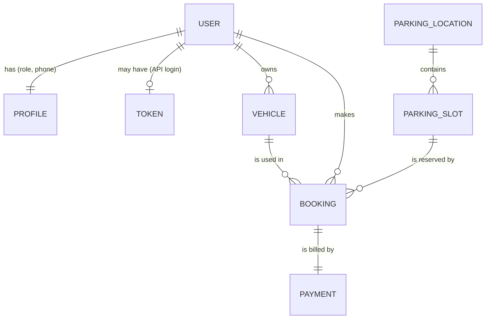

# Database schema

Generated from the Django models (`python tools/build_docs.py`). The application uses Django's ORM, so the schema is created by the
migrations in each app (`python manage.py migrate`); there is no hand-written SQL.

**Engines.** SQLite is the default and the engine the whole test suite and every delivery check ran on. MySQL 8.0.16 or newer is supported by
configuration (`DB_ENGINE=mysql`, see the deployment guide) but was **not** tested here. On MySQL the server needs the time-zone tables loaded
(`mysql_tzinfo_to_sql`), otherwise the dashboard's per-day charts come back empty.

## Entity relationship diagram

## The assignment's tables

| Assignment | Table here | Notes |
|---|---|---|
| Users | `auth_user` + `accounts_profile` | Django's user table for credentials; the profile adds the role (`user`/`admin`) and phone |
| Parking_Locations | `parking_parkinglocation` | Includes the hourly rate and opening hours |
| Parking_Slots | `parking_parkingslot` | Type (car, bike, ev, accessible) and status (available, occupied, unavailable) |
| Parking_Bookings | `bookings_booking` | Time window, status, rate snapshot, check-in/out times |
| Vehicles | `bookings_vehicle` | Owned by one user; plate numbers are unique per user |
| Payments | `payments_payment` | One per booking; amount, amount paid, status, simulated transaction id |
| (extra) | `authtoken_token` | API login tokens |

## Design notes

- **Money** is stored as `DECIMAL`, never floating point. A booking keeps a **snapshot of the hourly rate** (`bookings_booking.hourly_rate`) so changing a location's rate never changes an existing booking.
- **History is protected.** Bookings point to users, slots and vehicles with `PROTECT`, so anything that has bookings cannot be deleted (use `is_active` / `unavailable` instead). A payment cannot be deleted while its booking exists either.
- **Integrity is enforced in the database where possible:** unique `(location, slot_number)`, unique `(user, plate_number)`, unique booking reference, unique transaction id, `end_time > start_time`, and non-negative payment amounts (check constraints).
- **SQLite settings.** SQLite allows one writer at a time. The project starts every SQLite transaction in `IMMEDIATE` mode with a 20-second wait (`config/settings.py`), so simultaneous bookings or payments queue up instead of failing with "database is locked". That is plenty for a demo or modest traffic; for heavy write traffic use MySQL.
- **No double bookings.** Overlap between two bookings of the same slot cannot be expressed as a portable constraint, so it is checked in `apps/bookings/services.py` inside a transaction that locks the slot row (`SELECT ... FOR UPDATE` on MySQL/PostgreSQL; SQLite serialises writers). A threaded test (`apps/core/test_workflows.py`) books one slot from 8 threads at once and asserts exactly one wins.
- **Slot status vs. bookings.** `parking_parkingslot.status` is the slot's state *right now* (it changes at check-in/check-out and when an admin marks maintenance). Availability for a future period comes from the bookings table.
- **Indexes:** every foreign key, plus `(slot, start_time, end_time)` on bookings for the overlap query.

## Tables

### `auth_user`

Users within the Django authentication system are represented by this

| Column | Type | Null | Notes |
|---|---|---|---|
| `id` | integer (auto) | no | primary key |
| `password` | varchar(128) | no |  |
| `last_login` | datetime | yes |  |
| `is_superuser` | boolean | no | default `False` |
| `username` | varchar(150) | no | unique |
| `first_name` | varchar(150) | no |  |
| `last_name` | varchar(150) | no |  |
| `email` | varchar(254) | no |  |
| `is_staff` | boolean | no | default `False` |
| `is_active` | boolean | no | default `True` |
| `date_joined` | datetime | no | default `now()` |

### `accounts_profile`

| Column | Type | Null | Notes |
|---|---|---|---|
| `id` | bigint (auto) | no | primary key |
| `user_id` | bigint | no | unique; -> `auth_user` (one-to-one, on delete CASCADE) |
| `role` | varchar(10) | no | one of: `user`, `admin`; default `user` |
| `phone` | varchar(16) | no |  |
| `created_at` | datetime | no | set on creation |
| `updated_at` | datetime | no | updated on every save |

### `authtoken_token`

The default authorization token model.

| Column | Type | Null | Notes |
|---|---|---|---|
| `key` | varchar(40) | no | primary key |
| `user_id` | bigint | no | unique; -> `auth_user` (one-to-one, on delete CASCADE) |
| `created` | datetime | no | set on creation |

### `parking_parkinglocation`

| Column | Type | Null | Notes |
|---|---|---|---|
| `id` | bigint (auto) | no | primary key |
| `name` | varchar(120) | no |  |
| `address` | varchar(255) | no |  |
| `city` | varchar(80) | no |  |
| `description` | text | no |  |
| `opening_time` | time | no | default `00:00` |
| `closing_time` | time | no | default `23:59` |
| `hourly_rate` | decimal(8,2) | no | default `20.00` |
| `is_active` | boolean | no | default `True` |
| `created_at` | datetime | no | set on creation |
| `updated_at` | datetime | no | updated on every save |

- unique constraint `uniq_location_name_city`: name, city

### `parking_parkingslot`

| Column | Type | Null | Notes |
|---|---|---|---|
| `id` | bigint (auto) | no | primary key |
| `location_id` | bigint | no | -> `parking_parkinglocation` (many-to-one, on delete CASCADE) |
| `slot_number` | varchar(20) | no |  |
| `slot_type` | varchar(12) | no | one of: `car`, `bike`, `ev`, `accessible`; default `car` |
| `status` | varchar(12) | no | one of: `available`, `occupied`, `unavailable`; default `available` |
| `notes` | varchar(200) | no |  |
| `created_at` | datetime | no | set on creation |
| `updated_at` | datetime | no | updated on every save |

- unique constraint `uniq_slot_per_location`: location, slot_number

### `bookings_vehicle`

| Column | Type | Null | Notes |
|---|---|---|---|
| `id` | bigint (auto) | no | primary key |
| `user_id` | bigint | no | -> `auth_user` (many-to-one, on delete CASCADE) |
| `plate_number` | varchar(15) | no |  |
| `vehicle_type` | varchar(10) | no | one of: `car`, `bike`, `ev`; default `car` |
| `model_name` | varchar(60) | no |  |
| `created_at` | datetime | no | set on creation |

- unique constraint `uniq_vehicle_per_user`: user, plate_number

### `bookings_booking`

| Column | Type | Null | Notes |
|---|---|---|---|
| `id` | bigint (auto) | no | primary key |
| `reference` | varchar(12) | no | unique |
| `user_id` | bigint | no | -> `auth_user` (many-to-one, on delete PROTECT) |
| `slot_id` | bigint | no | -> `parking_parkingslot` (many-to-one, on delete PROTECT) |
| `vehicle_id` | bigint | no | -> `bookings_vehicle` (many-to-one, on delete PROTECT) |
| `start_time` | datetime | no |  |
| `end_time` | datetime | no |  |
| `status` | varchar(12) | no | one of: `confirmed`, `checked_in`, `completed`, `cancelled`, `no_show`; default `confirmed` |
| `hourly_rate` | decimal(8,2) | no | default `0` |
| `checked_in_at` | datetime | yes |  |
| `checked_out_at` | datetime | yes |  |
| `cancelled_at` | datetime | yes |  |
| `created_at` | datetime | no | set on creation |
| `updated_at` | datetime | no | updated on every save |

- check constraint `booking_end_after_start`: end_time > start_time
- index on (slot, start_time, end_time)

### `payments_payment`

| Column | Type | Null | Notes |
|---|---|---|---|
| `id` | bigint (auto) | no | primary key |
| `booking_id` | bigint | no | unique; -> `bookings_booking` (one-to-one, on delete PROTECT) |
| `amount` | decimal(10,2) | no | default `0.00` |
| `amount_paid` | decimal(10,2) | no | default `0.00` |
| `status` | varchar(10) | no | one of: `pending`, `paid`, `failed`, `refunded`, `cancelled`; default `pending` |
| `method` | varchar(10) | no |  |
| `transaction_id` | varchar(24) | yes | unique |
| `is_simulated` | boolean | no | default `True` |
| `note` | varchar(200) | no |  |
| `paid_at` | datetime | yes |  |
| `refunded_at` | datetime | yes |  |
| `created_at` | datetime | no | set on creation |
| `updated_at` | datetime | no | updated on every save |

- check constraint `payment_amount_gte_0`: amount >= 0
- check constraint `payment_paid_gte_0`: amount_paid >= 0
